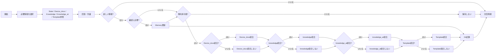

# OKF_Design
Open Knowledge Format（OKF）を、LLM / Agentが継続利用する外部メモリーの保存・整理形式として活用するための設計・運用上の知見をまとめた資料です。

## Repository Guide
このリポジトリは、目的別に4つの領域へ分けています。

```text
.
├── README.md プロジェクトの入口
│
├── docs/ 
│   └── リポジトリ全体の運用・設計・仕様を管理するエリア
│
├── instructions/
│   └── LLM / Agentへ与えるカスタム指示・定期整理プロンプト
│
├── okf_repository/
│   └── OKF外部メモリーのリポジトリ構成例
│
└── core/
    └── ネットワーク検証自動化プラットフォーム

```
### docs/
OKFをどのように設計し、どのように運用しているかを説明する資料です。
 - [AGENTS.md](./docs/AGENTS.md)
 - [INDEX.md](./docs/INDEX.md)
 - [ARCHITECTURE.md](./docs/ARCHITECTURE.md)
 - [DEVELOPMENT_GUIDE.md](./docs/DEVELOPMENT_GUIDE.md)
 - [SPEC.md](./docs/SPEC.md)
 - [GLOSSARY.md](./docs/GLOSSARY.md)
 - [NAME_RULE.md](./docs/NAME_RULE.md)
 - [README.md](./docs/README.md)

### instructions/
LLM / Agentへ与える運用指示です。
 - [INDEX.md](./instructions/INDEX.md)

### okf_repository/
OKFを使った外部メモリー用Gitリポジトリの構成例です。
 - [README.md](./okf_repository/README.md)
 - [device_docs/](./okf_repository/device_docs/)
    - [INDEX.md](./okf_repository/device_docs/INDEX.md)
    - [nxos_command_reference.md](./okf_repository/device_docs/cisco/nxos_command_reference.md)
    - [iosxe_command_reference.md](./okf_repository/device_docs/cisco/iosxe_command_reference.md)
    - [eos_command_reference.md](./okf_repository/device_docs/arista/eos_command_reference.md)

 - [template/](./okf_repository/template/)
    - [INDEX.md](./okf_repository/template/INDEX.md)
    - [testcase_template.md](./okf_repository/template/testcase_template.md)
    - [incident_template.md](./okf_repository/template/incident_template.md)
    - [python_template.md](./okf_repository/template/python_template.md)
    - [robot_template.md](./okf_repository/template/robot_template.md)

 - [knowledge_at/](./okf_repository/knowledge_at/)
    - [INDEX.md](./okf_repository/knowledge_at/INDEX.md)
    - [scenario/](./okf_repository/knowledge_at/scenario/)
    - [testcases/](./okf_repository/knowledge_at//testcases/)
    - [incidents/](./okf_repository/knowledge_at//incidents/)

 - [knowledge/](./okf_repository/knowledge/)
    - [INDEX.md](./okf_repository/knowledge//INDEX.md)
    - [concepts/](./okf_repository/knowledge/concepts/)
    - [workflows/](./okf_repository/knowledge/workflows/)
    - [tools/](./okf_repository/knowledge/tools/)
    - [references/](./okf_repository/knowledge/references/)
    - [experiments/](./okf_repository/knowledge/experiments/)
    - [decisions/](./okf_repository/knowledge/decisions/)

 - [memory/](./okf_repository/memory/)
    - [state](./okf_repository/memory/state/)
    - [events](./okf_repository/memory/events/)

### core/
作成したPython / Robotframework ファイルを実行するためのネットワーク検証自動化プラットフォームです。
 - [core/](./core/)

 ## Background
LLMを長期間利用すると、同じテーマが複数の会話やツールにまたがり、現在状態・決定事項・数値・構成・次回開始点などを再説明する必要が生じます。  
この運用では、会話全文そのものを記憶として保存するのではなく、

> **次回、正確に作業を再開するために必要な現在状態**

を外部へ保存します。  
さらに、そこから得られた再利用可能な原則・手順・検証知識は、現在状態とは分離して Knowledge として保存します。

## Architecture
基本構成は、1つのGitリポジトリ内に用途の異なる5つの OKF Bundle を配置する方式です。

```text
External Memory Repository
│
├── device_docs/ 
│   ├── INDEX.md 
│   ├── cisco/ 
│   │   ├── nxos_command_reference.md 
│   │   └── iosxe_command_reference.md 
│   └── arista/ 
│       └── eos_command_reference.md 
│
├── template/ 
│   ├── INDEX.md 
│   ├── testcase_template.md 
│   ├── incident_template.md 
│   ├── python_template.md 
│   └── robot_template.md 
│
├── Knowledge_at/ 
│   ├── INDEX.md 
│   ├── scenario/ 
│   ├── testcases/ 
│   └── incidents/ 
│
├── Knowledge/ 
│   ├── INDEX.md 
│   ├── concepts/
│   ├── workflows/
│   ├── tools/
│   ├── references/
│   ├── experiments/
│   └── decisions/
│
└── memory/ 
    ├── state/ 
    └── events/ 
```

Memoryでは、

- **Memory State** = 現在のSource of Truth
- **Memory Event** = 独立して残す価値がある重要な状態遷移

を区別します。

## 利用サイクル

必要な情報だけを参照し、作業によって生じた変化をMemory・Device_docs・Knowledge・Knowledge_at・Templateへ反映します。



Memoryには現在状態を、Knowledgeには固有の状態から切り離して再利用できる知識を保持します。  
過去の細かな変更はGit履歴へ委ね、現在利用する情報をSource of Truthとして維持します。

## Design Principles
この構成では、OKFだけで「記憶機能」が成立すると考えているわけではありません。  
OKFは外部メモリーの保存・分類・参照単位として利用し、以下を組み合わせて運用します。

 - State / Event / Knowledge / Knowledge_at / Device_docs / Templateの責務分離
 - Indexを使った段階的なContext選択
 - 保存するかどうかの判断ルール
 - Read / Writeフロー
 - Gitによる履歴・差分管理
 - 定期的な統合・重複整理
 - 秘密情報や不要情報を保存しないルール

また、Git履歴から過去状態を確認できるため、現行ファイルへ変更履歴を無制限に蓄積しません。  
現在の作業継続・判断・再利用に不要になった重複情報は統合・整理し、現在のSource of Truthを正確に保つことを優先します。

## Scope
この資料で扱うもの:

 - OKFを利用した外部メモリー構成
 - Memory State / Memory Event / Knowledge / Knowledge_at / Device_docs / Template
 - Read / Writeのデータフロー
 - Gitを利用した履歴管理
 - 保存・統合・整理の運用ルール
 - LLM / Agentへ与える指示
 - OKFリポジトリの構成例
 - 運用から得られた効果と課題

扱わないもの:

 - OKF仕様そのものの詳細解説
 - そのままシステムへ導入できる完成済み実装

## Recommended Reading Order
初めて見る場合は、次の順で確認すると全体像を追いやすくなります。

1. [AGENTS.md](./docs/AGENTS.md)
2. [README.md](./docs/README.md)
3. [INDEX.md](./docs/INDEX.md)
4. [ARCHITECTURE.md](./docs/ARCHITECTURE.md)
5. [SPEC.md](./docs/SPEC.md)
6. [DEVELOPMENT_GUIDE.md](./docs/DEVELOPMENT_GUIDE.md)
7. [NAME_RULE.md](./docs/NAME_RULE.md)
8. [GLOSSARY.md](./docs/GLOSSARY.md)

## Positioning

この資料は、OKFの仕様紹介そのものではなく、

> **外部メモリーという仕組みの中で、OKFをどのように利用・運用するか**

を示すためのものです。  
プロジェクト・システム・環境などのState管理へ応用する際の参考資料として利用できる構成を意図しています。